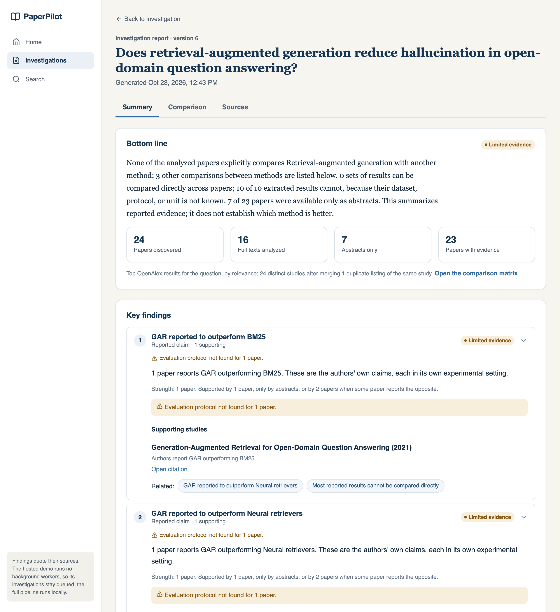
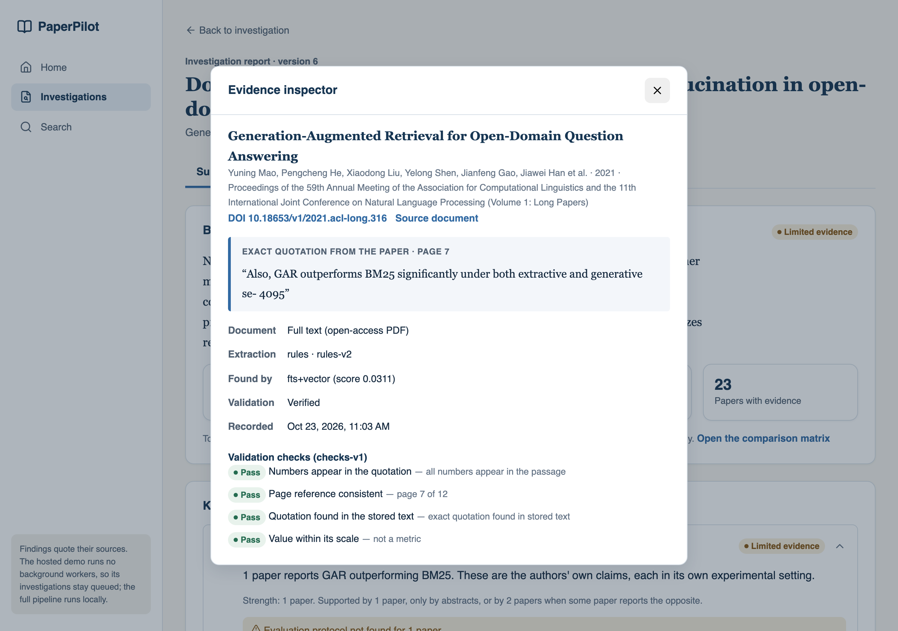

# PaperPilot

An evidence-backed research investigation engine. Ask a technical research question;
PaperPilot finds relevant papers, extracts reported evidence with source passages,
flags experiments that cannot be fairly compared, and produces a traceable report.

> **Status: Milestone 6 (comparison and reports).** An investigation runs a Kafka pipeline:
> discovery (OpenAlex) → permitted open-access PDFs (SSRF-safe, robots-aware) → page-exact
> chunks with local embeddings → hybrid search → rule-based evidence with exact quotations
> and deterministic validation → deterministic comparability rules → a versioned report
> with published strength labels, readable in three levels down to the quoted source.
> Measured quality (small, manually reviewed gold set): [docs/evaluation.md](docs/evaluation.md).
> The pipeline runs in the local Docker setup; the public demo has no workers.
> See [docs/roadmap.md](docs/roadmap.md).

**Live demo:** https://paperpilot-web-tfx4.onrender.com (free tier: first load after
idle can take about a minute). API docs: https://paperpilot-api-2ykf.onrender.com/docs

PaperPilot evaluates *reported* evidence. It does not prove scientific reproducibility.

| Report summary | Evidence inspector |
|---|---|
|  |  |

Five-minute walkthrough: [docs/demo.md](docs/demo.md).

## Quick start (Docker)

Requires Docker with Compose v2.

```bash
cp .env.example .env        # optional; defaults work for local use
docker compose up --build -d --wait
./scripts/smoke-test.sh     # end-to-end check through the frontend proxy
EXPECT_PIPELINE=1 PIPELINE_TIMEOUT=600 ./scripts/smoke-test.sh   # also wait for the report
```

The pipeline check uses live OpenAlex and downloads open-access PDFs with
crawl delays, so it takes a few minutes (about 3.5 on the M7 clean run).

| URL | What |
|---|---|
| http://localhost:8080 | Landing page; the app is at `/app` (nginx serves the SPA and proxies `/api`) |
| http://localhost:8000/docs | API reference (OpenAPI) |
| http://localhost:8000/health/ready | Readiness: 200 when the database answers, else 503 |

Stop with `docker compose down`. Add `-v` to also delete the database and Kafka volumes.

Pipeline operations (full runbook: [docs/operations.md](docs/operations.md)):

```bash
docker compose up -d --scale discovery-worker=3        # more consumers in the group
docker compose logs -f discovery-worker outbox-dispatcher
docker compose exec kafka /opt/kafka/bin/kafka-consumer-groups.sh \
  --bootstrap-server localhost:9092 --describe --group discovery-workers   # partitions and lag
docker compose run --rm --no-deps api python -m app.ops.metrics          # backlog, lag, latency
docker compose run --rm --no-deps api python -m app.ops.dead_letters list
```

## Local development

```bash
cp .env.example .env                            # backend reads DATABASE_URL from it
docker compose up -d db                         # Postgres + pgvector on localhost:5433

cd backend
python3.12 -m venv .venv && source .venv/bin/activate
pip install -r requirements-dev.txt
alembic upgrade head
uvicorn app.main:create_app --factory --reload  # http://localhost:8000

cd ../frontend
npm ci
npm run dev                                     # http://localhost:5173, proxies /api to :8000
```

## Checks

| Area | Command (run inside the folder) |
|---|---|
| Backend lint/format | `ruff check . && ruff format --check .` |
| Backend types | `mypy app tests` |
| Backend tests | `pytest` (needs the `db` container; uses a separate `paperpilot_test` database) |
| Frontend | `npm run typecheck && npm run lint && npm test && npm run build` |
| Color contrast | `npm run contrast` (WCAG 2.2 AA for every token pair the UI uses) |

GitHub Actions ([.github/workflows/ci.yml](.github/workflows/ci.yml)) runs all of these,
then builds the full Compose stack and runs the smoke test.

## Architecture

FastAPI modular monolith + PostgreSQL (with pgvector) as the single source of truth.
Background processing will run in separate worker processes coordinated through Kafka
with a transactional outbox. Details: [docs/architecture.md](docs/architecture.md) and
the decision records in [docs/adr/](docs/adr/). Security controls and known gaps:
[docs/security.md](docs/security.md).

```
backend/    FastAPI app, workers (app/workers), event contracts (app/events),
            Alembic migrations, pytest suite
frontend/   React + TypeScript + Vite, design tokens in src/styles/tokens.css
docs/       architecture, ADRs, roadmap
scripts/    smoke test
```

## API (v1)

| Method | Path | Result |
|---|---|---|
| POST | `/api/v1/investigations` | 201 + `Location`; body `{"question": "..."}` (10–500 chars) |
| GET | `/api/v1/investigations?limit=20&offset=0` | Newest first; `limit` 1–100 |
| GET | `/api/v1/investigations/stats` | Total and count per status |
| GET | `/api/v1/investigations/{id}` | 200, or 404 if unknown |
| GET | `/api/v1/papers/search?q=...` | OpenAlex search; filters `from_year`, `to_year`, `open_access_only`, `sort` (`relevance`, `citations`, `newest`), `page`, `per_page` (≤25). Cached 24 h |
| GET | `/api/v1/papers/{id}` | Stored paper metadata with provenance |
| GET | `/api/v1/investigations/{id}/tasks` | Pipeline tasks: status, attempts, errors, results |
| GET | `/api/v1/investigations/{id}/papers` | Discovered papers in rank order |
| GET | `/api/v1/system/pipeline` | Outbox backlog and oldest pending age |
| GET | `/api/v1/investigations/{id}/evidence` | Evidence with quotations, pages, provenance, and validation checks |
| GET | `/api/v1/papers/{id}/document` | What text is held for a paper (full text or abstract and why) |
| GET | `/api/v1/investigations/{id}/report` | Latest report version (summary, findings, comparison, sources); 404 until built |
| GET | `/api/v1/evidence/{id}` | One evidence record with its paper, document source, and validation checks |
| GET | `/health/live`, `/health/ready` | Liveness / readiness |

## Known limitations

- Evidence extraction is rule-based. On the gold set it finds about 1 in 10 key
  facts, so reports understate what papers contain. Measurements and causes:
  [docs/evaluation.md](docs/evaluation.md). Full text comes only from open-access PDFs.
- Reports are assembled from templates. They never rank methods and say so.
- The document and evidence workers use a 2.2 GB image (CPU-only torch and the
  embedding model); the first `docker compose up --build` takes several minutes.
- Paper search depends on OpenAlex usage limits; see
  [ADR 0005](docs/adr/0005-openalex-provider-and-search-cache.md).
- No authentication. Creating investigations is rate limited per client and capped
  per day; see [docs/deployment.md](docs/deployment.md#public-demo-safeguards).
- The public demo runs on free tiers (Render + Neon) and sleeps when idle; the first
  request can take about a minute. Kafka and workers (from M3) will be local-only. Setup and limits: [docs/deployment.md](docs/deployment.md).
