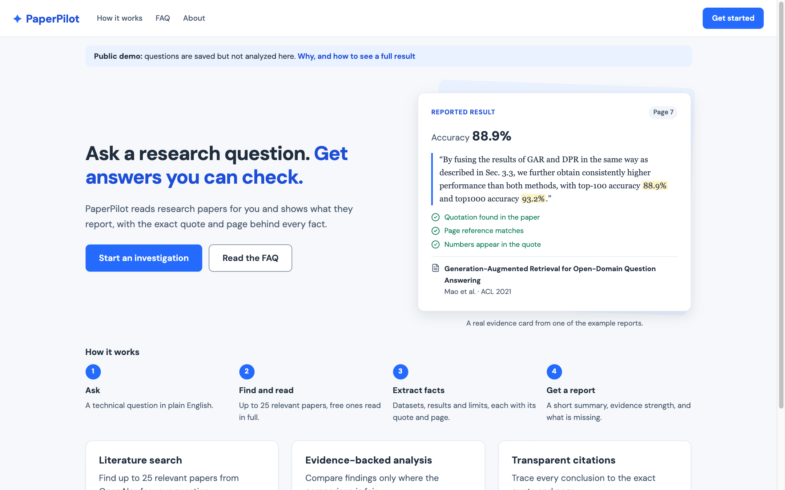
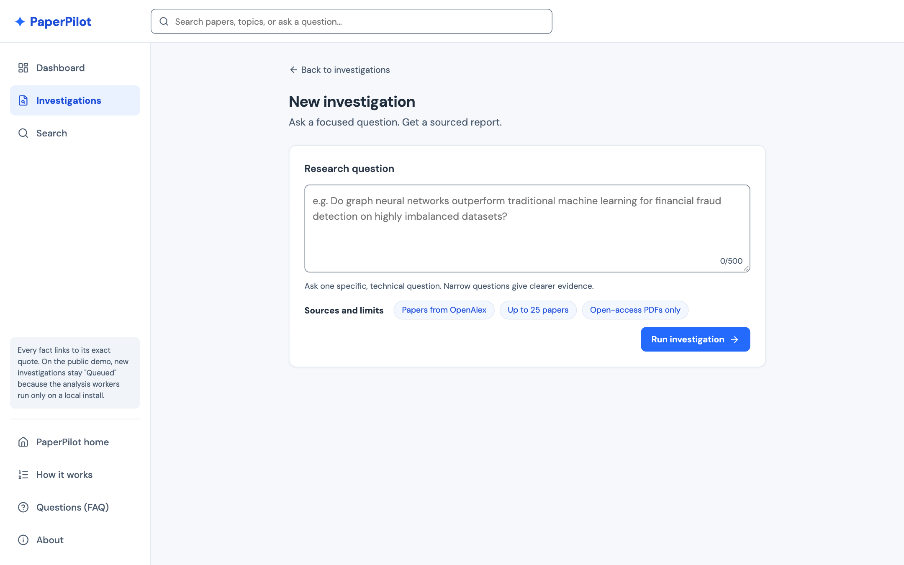
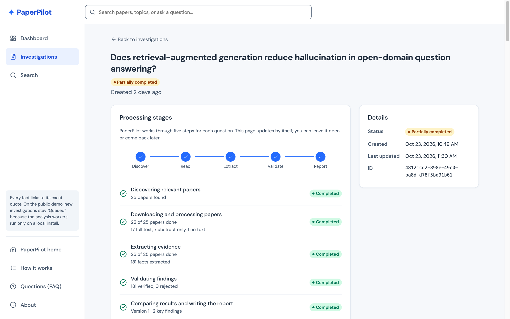
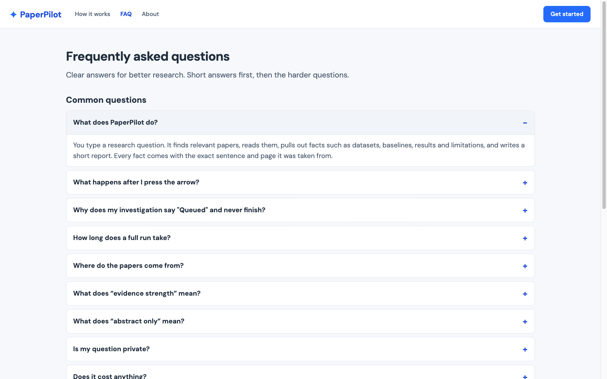
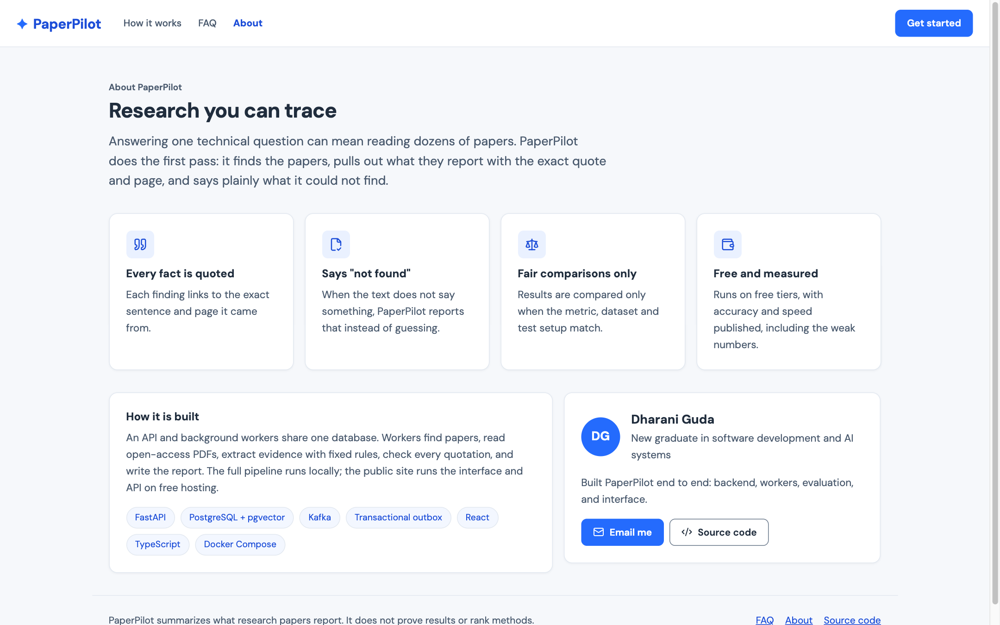
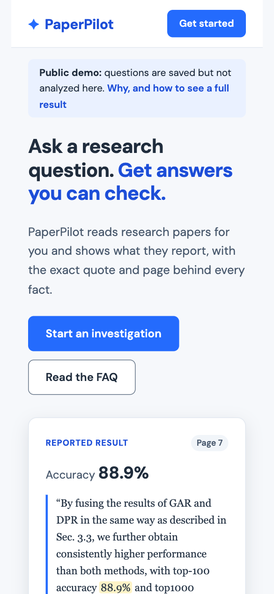
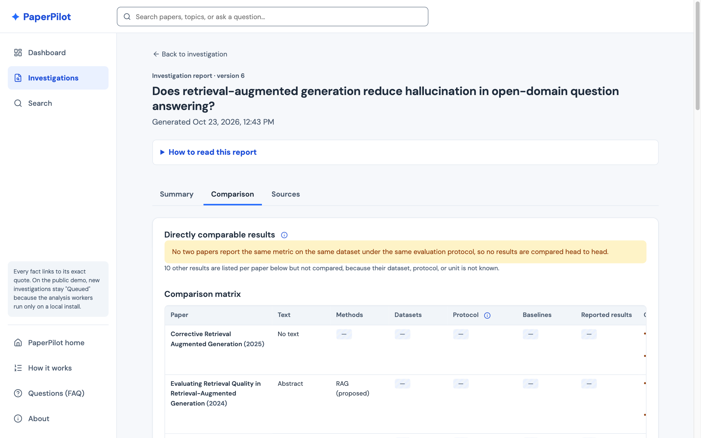
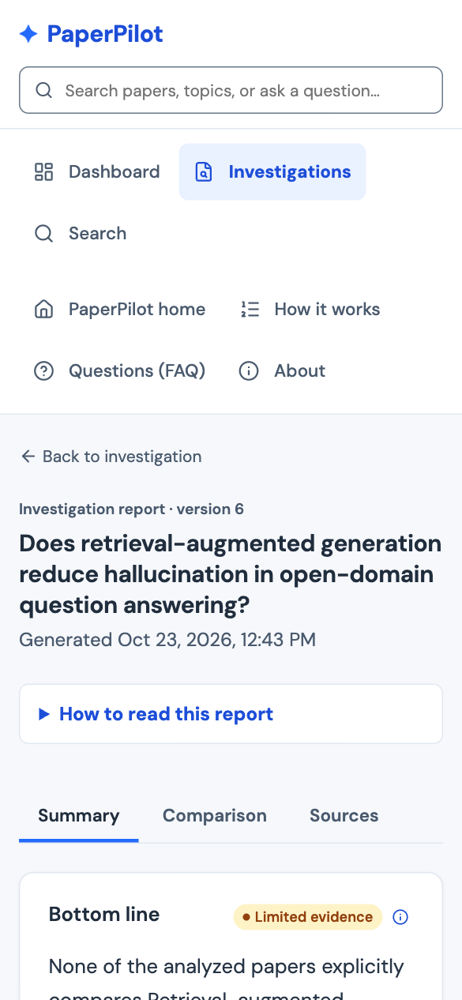

# Demo Guide

A five-minute walkthrough of the local stack, plus what the public demo can and
cannot show.

## Before the demo

```bash
docker compose up --build -d --wait
EXPECT_PIPELINE=1 PIPELINE_TIMEOUT=600 ./scripts/smoke-test.sh
```

Then create an investigation for a question you know. It should finish before
the demo starts: about 2–4 minutes for 25 papers with live OpenAlex and PDF
downloads. The question used throughout the docs is: *Does retrieval-augmented
generation reduce hallucination in open-domain question answering?*

## Walkthrough

1. **Landing → Get started → New investigation** (http://localhost:8080). Type
   the question. The API stores the investigation and an outbox event in one
   transaction and returns at once.
2. **Investigation page.** The task list shows the pipeline: discovery,
   then per paper "process document" and "extract evidence", then
   "build report". Mention what is happening behind it: Kafka topics,
   consumer groups, idempotent workers, retries with backoff.
   Optional: in a terminal, `docker compose run --rm --no-deps api python -m app.ops.metrics`
   shows the outbox backlog and consumer lag.
3. **View report → Summary** (level 1):
   - The bottom line answers the question only from extracted evidence, and
     ends by saying it does not rank methods.
   - Point at the strength label, "What do the evidence strength labels mean?",
     and the scope counts (full text vs abstract only, duplicates merged).
4. **Expand a finding** (level 2). The caveat stays visible while the finding
   is collapsed. Expanded, it shows supporting studies, the strength reason,
   and related findings.
5. **Open citation** (level 3, evidence inspector):
   - the exact quotation and page;
   - the source document;
   - how the passage was retrieved (`fts+vector` with its RRF score);
   - the extraction version;
   - the four validation checks.

   Every claim in the report leads here.
6. **Comparison tab.** No results are comparable head to head. Each row says
   why (dataset, protocol, or unit unknown). The matrix scrolls inside its box
   on a phone.
7. **Honesty about quality** ([evaluation.md](evaluation.md)):
   - On an 84-fact gold set, retrieval delivers 93% of the needed passages.
   - Rule extraction finds about 1 in 10 facts.
   - Every quotation it does produce is real.
8. **Resilience (optional, 1 minute).** `docker compose stop discovery-worker`,
   create an investigation, and show it waiting. Then
   `docker compose start discovery-worker` and show it continue. Nothing is
   lost, because the event sat in Kafka and the outbox.

## Public demo

https://paperpilot-research.onrender.com runs the API and frontend on free tiers
(Render + Neon).
- It shows the UI, paper search (OpenAlex, cached), creating investigations,
  and the rate limits.
- Kafka and the workers are local-only, because no free host runs them
  persistently ([ADR 0004](adr/0004-zero-cost-deployment.md)). Investigations
  created there stay `queued`, and the UI says so after a minute.
- The first request after idle can take about a minute while the instance
  wakes.

## Screenshots

| Landing page | New investigation |
|---|---|
|  |  |

| Investigation progress | FAQ |
|---|---|
|  |  |

| About | Landing on a phone |
|---|---|
|  |  |

| Report summary (level 1–2) | Evidence inspector (level 3, drawer) |
|---|---|
|  |  |

| Comparison matrix | Phone width (390 px) |
|---|---|
|  |  |

All screenshots are from the local stack, showing the real RAG investigation
described in [evaluation.md](evaluation.md).
